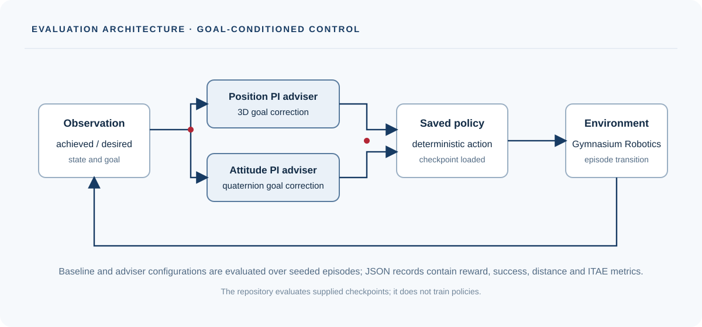

# AAC: Adviser–Actor–Critic

[Project homepage](https://paoshou-china.github.io/Adviser-Actor-Critic/) · [Quick start](#quick-start) · [Source](https://github.com/PaoShou-China/Adviser-Actor-Critic)

AAC evaluates saved goal-conditioned robotics policies with control-theoretic advisers. The current repository contains evaluation and adviser code; it does **not** include policy training code.

## Method implemented

- **Position adviser:** a three-dimensional PI correction with thresholded integral accumulation.
- **Attitude adviser:** quaternion goal-error correction using the imaginary quaternion components and bounded integral accumulation.
- **Combined adviser:** applies the position and attitude controllers to the corresponding portions of a 7D pose goal.
- **Evaluation:** compares baseline and adviser-controlled episodes on supported Gymnasium Robotics environments. Episode records include reward, success, final position/rotation distance and ITAE metrics.

The supported environment mapping and checkpoint loading are defined in `utils.py`. Related references: [Metric-Residual Network](https://github.com/Cranial-XIX/metric-residual-network) and [Gymnasium Robotics](https://github.com/Farama-Foundation/Gymnasium-Robotics).

## Installation

The Conda environment specification is `aac_environment.yml`:

```bash
conda env create -f aac_environment.yml
conda activate aac
```

## Quick start

Place compatible checkpoints under `model/<environment>/`. Names must end in `_best.pt`, begin with the environment name and contain a seed token such as `_sd100_`.

```bash
python main.py --env FetchReach --episodes 10
```

Run the configured environment sweep with the CLI defaults:

```bash
python main.py
```

Use `python main.py --help` to see available options, including `--model-dir`, `--kp`, `--ki-range` and `--sigma-range`. Results are written to `log/` as JSON episode records and summaries.

## Repository map

- `main.py`: CLI and batch evaluation setup.
- `evaluate.py`: episode execution and result aggregation.
- `advisers.py`: position, attitude and combined adviser implementations.
- `utils.py`: environment map, policy loading and helpers.
- `model/`: example saved checkpoints.

Episode evaluation stops on either Gymnasium terminal or truncation signals. The output includes one record per paired baseline/adviser episode plus a final summary object.

## Reproducibility

The evaluation seed is derived from the checkpoint filename. Preserve the filename convention when adding checkpoints. Evaluation requires compatible Gymnasium Robotics, MuJoCo and policy dependencies. Included checkpoints are examples; policy training is outside this repository.
